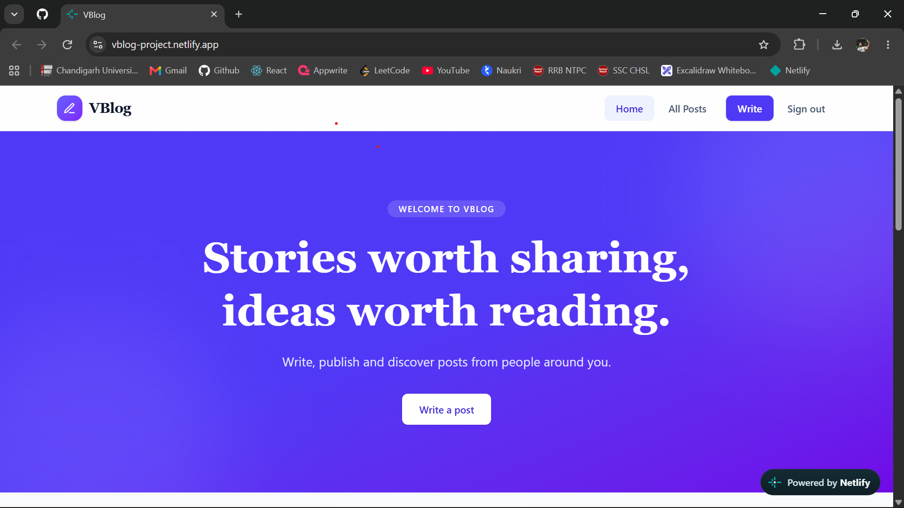
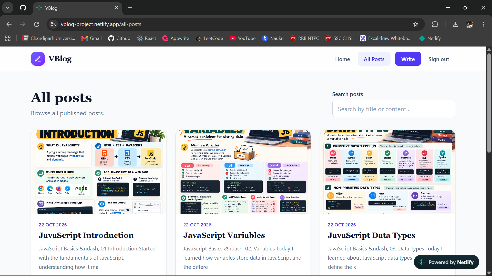
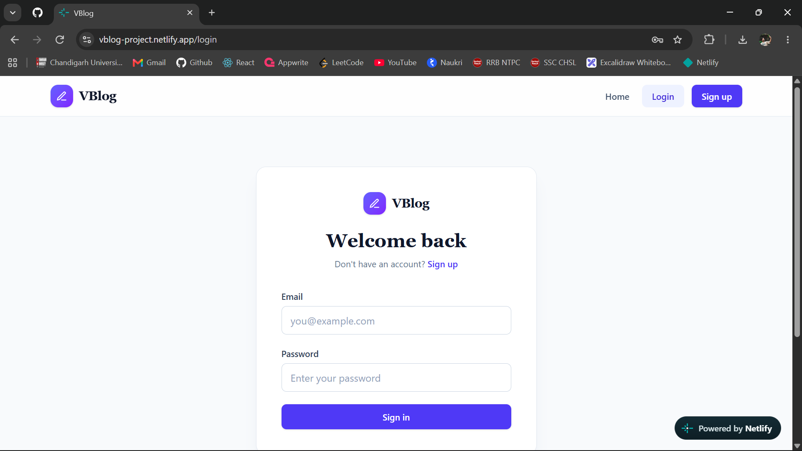

<div align="center">

# VBlog Modern Blogging Platform

### Stories worth sharing, ideas worth reading.

A modern blogging platform built with **React, Appwrite, Redux Toolkit, and Tailwind CSS**.

[](https://vblog-project.netlify.app/)
[](https://react.dev/)
[](https://vite.dev/)
[](https://tailwindcss.com/)
[](https://redux-toolkit.js.org/)
[](https://appwrite.io/)

</div>

---

## 📌 About the Project

**VBlog** is a responsive blogging application where users can discover published posts and, after signing in, create and manage their own content. The project combines a React-based interface with Appwrite backend services and Redux Toolkit for application state.

The goal of VBlog is to provide a clean writing and reading experience with straightforward navigation and a modern UI.

## 🖼️ Screenshots

### Home Page
<p align="center">
  
</p>

### Blog Listing
<p align="center">
  
</p>

### Login Page
<p align="center">
  
</p>

## ✨ Features

- **Authentication** — Sign in and sign up using Appwrite authentication.
- **Blog management** — Create, edit, publish, and delete posts.
- **Post discovery** — Browse published posts from the All Posts page.
- **Search** — Search posts by title or content.
- **Rich text editing** — Compose and format blog content.
- **Image uploads** — Store post images with Appwrite Storage.
- **State management** — Organize application state with Redux Toolkit.
- **Client-side routing** — Navigate between pages using React Router.
- **Responsive interface** — Layout designed for different screen sizes.

> Feature availability depends on the functionality enabled in the current deployment and Appwrite project.

## 🧰 Tech Stack

| Technology | Usage |
|---|---|
| React | Component-based user interface |
| Vite | Local development and production build |
| Tailwind CSS | Utility-first styling |
| Redux Toolkit | Application state management |
| React Router | Client-side navigation |
| Appwrite | Authentication, database, and file storage |
| JavaScript | Application logic |
| Git & GitHub | Version control and source hosting |
| Netlify | Live deployment |

## 🚀 Run Locally

### Prerequisites

- [Node.js](https://nodejs.org/) and npm
- [Git](https://git-scm.com/)
- An Appwrite project configured for the application

### 1. Clone the repository

Replace the URL below with your actual GitHub repository URL.

```bash
git clone https://github.com/YOUR_USERNAME/YOUR_REPOSITORY.git
cd YOUR_REPOSITORY
```

### 2. Install dependencies

```bash
npm install
```

### 3. Configure environment variables

Create a `.env` file in the project root. Use the exact variable names expected by your project's configuration file.

Example placeholders:

```env
VITE_APPWRITE_URL=your_appwrite_endpoint
VITE_APPWRITE_PROJECT_ID=your_appwrite_project_id
VITE_APPWRITE_DATABASE_ID=your_database_id
VITE_APPWRITE_COLLECTION_ID=your_collection_id
VITE_APPWRITE_BUCKET_ID=your_storage_bucket_id
```

If your code uses different variable names, update this example to match. Do not put server-side secrets or private credentials in frontend environment variables. Ensure `.env` is listed in `.gitignore`.

### 4. Start the development server

```bash
npm run dev
```

Open the local URL printed in the terminal.

### 5. Create a production build

```bash
npm run build
```

Optionally preview the build locally:

```bash
npm run preview
```

## 📂 Project Structure

The following is based on the structure planned for the project. Adjust it to match the files currently present in your repository.

```text
VBlog-Project/
├── public/
├── src/
│   ├── app/
│   │   └── store.js
│   ├── components/
│   │   ├── Auth/
│   │   ├── Blog/
│   │   ├── Common/
│   │   └── Layout/
│   ├── config/
│   │   └── appwrite.js
│   ├── features/
│   │   ├── auth/
│   │   └── blog/
│   ├── pages/
│   │   ├── Home.jsx
│   │   ├── Login.jsx
│   │   ├── Register.jsx
│   │   ├── CreatePost.jsx
│   │   ├── EditPost.jsx
│   │   └── Dashboard.jsx
│   ├── routes/
│   │   └── AppRoutes.jsx
│   ├── services/
│   │   └── appwriteService.js
│   ├── App.jsx
│   ├── main.jsx
│   └── index.css
├── .env.example
├── .gitignore
├── package.json
├── vite.config.js
├── tailwind.config.js
├── postcss.config.js
├── README.md
└── LICENSE
```

## 🌐 Live Demo

**[Open VBlog on Netlify →](https://vblog-project.netlify.app/)**

## 🛣️ Possible Improvements

- Add categories and tags for posts
- Add pagination and more advanced filtering
- Improve loading, empty, and error states
- Add user profile settings
- Expand accessibility and automated testing

## 🤝 Contributing

Suggestions and improvements are welcome. For a personal portfolio project, you can open an issue to discuss a change before submitting a pull request.

## 📄 License

If the repository contains a `LICENSE` file, see it for the applicable terms. Add a license file if you intend to specify how others may use, modify, or distribute this project.

---

<div align="center">

**Built with React, Appwrite, and a love for sharing ideas.**

[Live Demo](https://vblog-project.netlify.app/) · [Back to Top](#-vblog)

</div>
